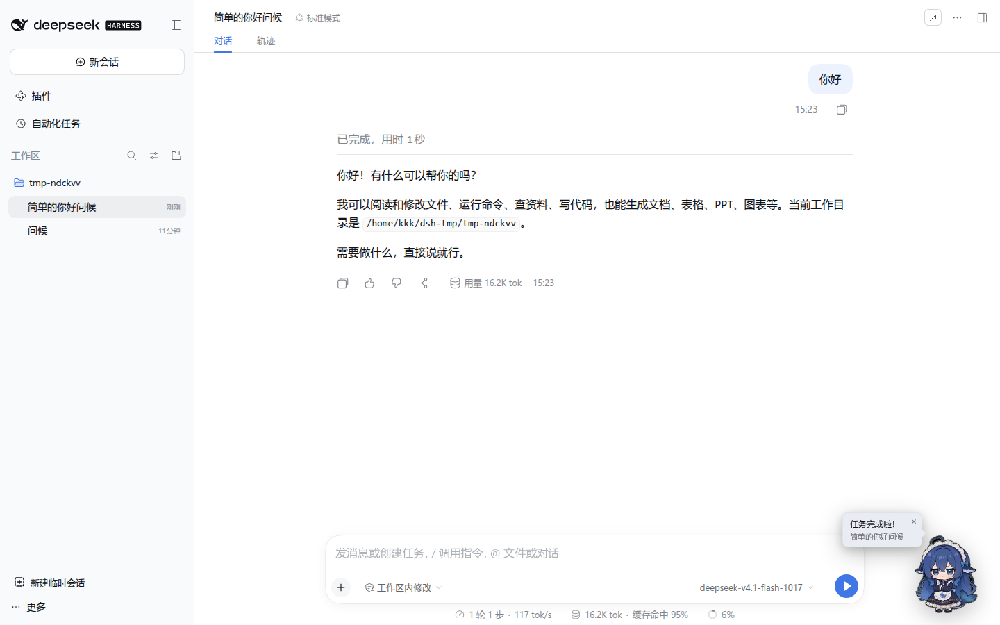
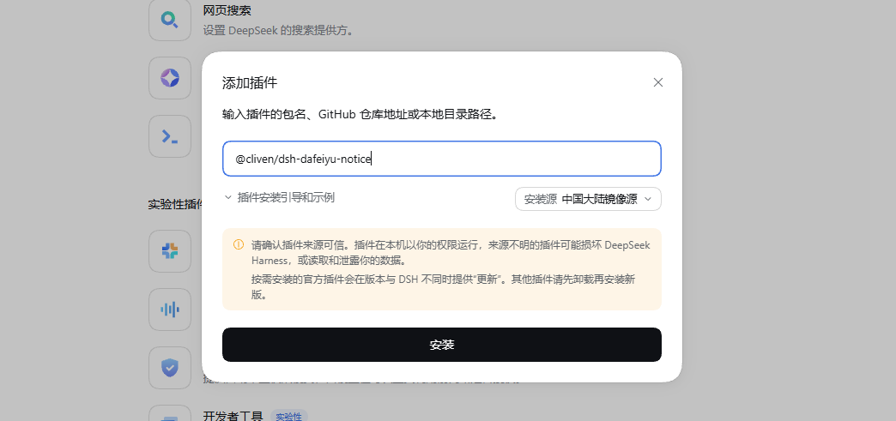

<p align="center">
  
</p>

<h1 align="center">dsh-dafeiyu-notice</h1>

<p align="center">
  <strong>大肥鱼你做完了就叫我</strong><br>
  DSH Web 的完成提醒插件：任务完成、等待回答、等待确认都会进入同一条大肥鱼队列，点一次切回一个会话；支持点击回应动画与钉钉提示音。
</p>

<p align="center">
  
</p>

## 目录

- [安装](#安装)
- [功能](#功能)
- [使用](#使用)
- [设置](#设置)
- [开发文档](#开发文档)
- [常见问题](#常见问题)
- [素材与许可](#素材与许可)

## 安装

在 DSH 的 **设置 → 插件 → 添加插件** 中填入插件名：

<p align="center">
  
</p>

```text
@cliven/dsh-dafeiyu-notice
```

也可以直接用命令行安装：

```bash
dsh plugin add @cliven/dsh-dafeiyu-notice
```

插件包内的 `cordis.patch.yml` 会自动把 `task-notify` 条目插入 profile，安装后重启 DSH Web 服务并刷新页面即可。

从源码构建并在本地挂载到 profile 的方法见 [开发文档](./docs/DEVELOPMENT.md#挂到-dsh-profile)。

## 功能

### 任务完成大肥鱼

任意 DSH 会话从“运行中”变为“空闲”，并且不是空白会话、没有待回答/待确认请求时，右下角会出现大肥鱼：

- 待机动画循环播放，气泡显示“任务完成啦！”和会话标题。
- 多个会话先后完成时排成 **FIFO 队列**，大肥鱼只出现一个，气泡显示“还有 N 个”。
- 同一会话重复触发只更新队列里的条目，不会重复占位。
- 用户主动停止生成（点击“停止生成”或连按两次 Esc）不会触发完成提醒。

### 点击切换会话与点击回应动画

点击大肥鱼（或聚焦后按 Enter / 空格）：

1. 立即打开 **队首** 会话，并把它从队列中移除。
2. 播放一段随机“点击回应”动画（9 段轮播，动作名单见上表），动画会跟着新页面继续播放。
3. 队列还有会话时，动画播完后回到待机，等下一次点击；队列清空时，动画播完最后一帧就直接收起。

点击回应动画共 9 段，随机选择，并避免与上一次连续重复：

| id | 名称 | 动作 |
| --- | --- | --- |
| `wave` | 元气挥手 | 举手欢呼挥手 |
| `happy` | 开心跃动 | 开心跳起、冒出爱心 |
| `shy` | 害羞惊讶 | 捂脸害羞 |
| `tickle` | 挠痒咯咯笑 | 被挠痒咯咯笑 |
| `angry` | 傲娇生气 | 生气鼓起脸转过身 |
| `scared` | 被吓一跳 | 猛地一激灵 |
| `meet` | 头顶开光 | 跳起来抓碎头顶的东西、爆闪星光 |
| `wake` | 惊醒 | 打瞌睡被惊醒 |
| `tumble` | 原地左转奔跑 | 左转一圈跑起来、摔一跤 |

气泡右上角的 `×` 可以随时清空整个队列并收起大肥鱼。

### 等待回答 / 等待确认

出现新的问答或审批请求时，处理和任务完成完全一样：

- 不是弹出会自动消失的 toast，而是把会话加入同一条大肥鱼队列。
- 队首标题显示“等你回答”或“等你确认”，气泡里显示“还有 N 个”。
- 用户点一次打开一个会话；队列里有几个请求，就多点几次。
- 问答和审批按发生顺序排队，不会被后来的任务完成插队。

### 提示音

- 任务完成使用内嵌的钉钉提示音；等待回答/确认使用另一段三音提示，便于区分。
- 浏览器自动播放策略要求页面先获得一次用户手势（点击或按键），之后才能稳定发声。
- MP3 被策略拦截时会自动退回 WebAudio 合成音，视觉提示不受影响。
- 大肥鱼已经显示时，新的提醒只入队，不重复响铃。

### 子智能体

子智能体（`subagent`、子智能体 fork 出来的会话、AgentTeams 成员）完成任务时**默认不提醒**，避免一个主任务在后台跑出大量提醒：

- 判定依据是宿主会话列表的元数据：`origin` 为 `subagent`，或带有所属主会话 `parentId` 的会话都算子智能体会话。
- 只跳过“任务完成”这一类；子智能体会话发起的 **等待回答 / 等待确认** 仍然照常提醒，否则请求可能一直无人处理。
- 需要看到子智能体完成提醒时，在设置里打开“子智能体完成”开关即可。

### 其它

- **拖动、缩放与记忆**：大肥鱼可以拖到任意位置；鼠标悬停时会显示右下角缩放手柄，拖动它调整大小（0.5～2 倍）。位置和大小都保存在 `localStorage`，刷新页面后恢复，窗口尺寸变化时会自动收回视口内。触屏设备没有悬停，手柄常显。
- **主题适配**：颜色使用宿主的 `--dsw-alias-*` 主题令牌，浅色/深色主题都可融入。
- **中英文文案**：跟随宿主语言，提供 `zh` / `en` 两套字典。
- **键盘与读屏**：大肥鱼是有 `role="button"` 的焦点元素，支持 Enter / 空格；读屏软件合成的 click 也能触发切换。

## 使用

| 操作 | 效果 |
| --- | --- |
| 点击大肥鱼 | 打开队首会话，播放一段随机点击回应动画 |
| 点击气泡 `×` | 清空提醒队列并收起大肥鱼 |
| 拖动大肥鱼 | 移动位置，松手后保存 |
| 悬停精灵后拖动右下角手柄 | 调整大小（0.5～2 倍），松手后保存 |
| 聚焦大肥鱼后按 Enter / 空格 | 等同于点击 |

完成、等待回答、等待确认共用同一条队列，消费顺序就是入队顺序：

```text
会话 A 完成   ─┐
会话 B 等你回答 ─┼─▶ 队列 [A完成, B回答, C确认] ──点击──▶ 打开 A，队列 [B, C]
会话 C 等你确认 ─┘                                ──点击──▶ 打开 B，队列 [C]
                                                  ──点击──▶ 打开 C，队列 []
```

队列清空后，最后一段点击回应动画按素材自身的帧数播完最后一帧就直接收起；点击后立刻切换到点击动画，不会再闪现点击前的画面。

## 设置

在 **设置 → 通用 → 任务完成提醒** 中可以调整：

| 设置 | 默认 | 说明 |
| --- | --- | --- |
| 提醒 | 开启 | 总开关；关闭后不再产生新的大肥鱼提醒 |
| 声音 | 开启 | 控制完成提示音与等待提示音；打开时会试听一次 |
| 子智能体完成 | 关闭 | 打开后，子智能体会话完成时也显示大肥鱼；等待回答/确认始终提醒 |

设置保存在 `localStorage`：

| 键 | 内容 |
| --- | --- |
| `dsh.taskNotify.settings.v1` | `{"enabled": true, "sound": true, "notifySubagent": false}` |
| `dsh.taskNotify.spritePos.v1` | `{"left": number, "top": number}`，单位：像素 |
| `dsh.taskNotify.spriteScale.v1` | 缩放比例，`0.5`～`2`，1 为基准大小 |

需要重置时，在浏览器控制台删除对应键并刷新页面即可。

## 开发文档

构建、测试、实现细节、素材生成和目录结构见 [docs/DEVELOPMENT.md](./docs/DEVELOPMENT.md)。

## 常见问题

### 任务完成或等待回答时没有大肥鱼

按顺序检查：

1. 设置页的“提醒”总开关是否开启。
2. 会话是否真的从运行中变为空闲，而不是被手动停止。
3. 完成提醒要求会话不是空白会话；等待回答/确认提醒要求宿主真的产生了新的待交互请求。
4. 是否在等子智能体的完成提醒：子智能体完成默认不提醒，需要打开“子智能体完成”开关。
5. 修改代码后是否重新执行过 `pnpm build`，并刷新了页面。
6. 浏览器控制台是否有插件加载错误。

### 没有声音

1. 先点击页面任意位置或按一次键，满足浏览器的手势要求。
2. 检查设置页的“声音”开关。
3. 检查系统/标签页是否静音。
4. 若 MP3 被策略拦截，插件会尝试 WebAudio 合成音；两者都不可用时只保留视觉提示。

### 点击大肥鱼没有切换会话

- 确认当前 DSH 版本提供 `uiWorkspace` 服务。
- 确认队列里的会话仍然存在；已删除或归档的会话可能无法打开。
- 如果刚点完最后一个会话，大肥鱼会在动画结束后收起，这是预期行为。

### 刷新后队列消失

提醒队列只保存在内存中，刷新页面会清空；这是为了避免恢复出已经过期的提醒。位置、大小和设置会保留。

### 大肥鱼跑到屏幕外

拖动回来即可；如果坐标或大小异常，删除 `localStorage` 里的 `dsh.taskNotify.spritePos.v1` / `dsh.taskNotify.spriteScale.v1` 后刷新。

## 素材与许可

- 本仓库代码采用 [MIT License](./LICENSE) 发布，Copyright (c) 2026 Quan Guanyu。
- 点击回应动画素材来自 [PC2005-cloud/dsh-pet](https://github.com/PC2005-cloud/dsh-pet)，由本仓库脚本离线转成雪碧图；使用或再分发请遵循原仓库的许可。
- 插件图标取自同一套待机素材，由 `scripts/build-icon.py` 生成。
- 钉钉提示音来自 `assets/dingtalk.mp3`，仅用于本插件提示。
